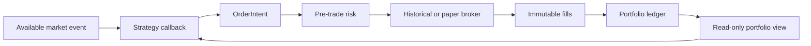
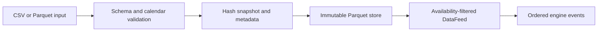
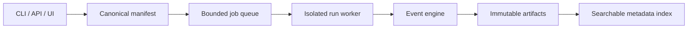
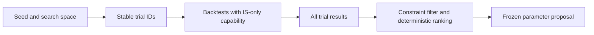
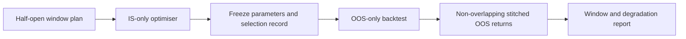
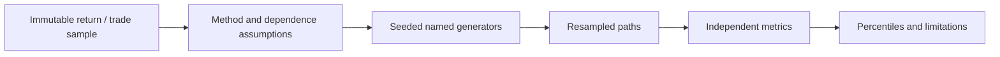
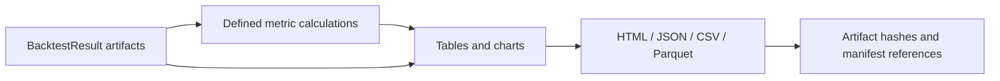

# System architecture

## Architecture decision
Use a Python modular monolith with a deterministic reference event engine. Pure
domain contracts have no dependency on FastAPI, UI, database or broker SDKs.
Application services orchestrate domains; adapters implement storage/data/brokers.
Python 3.12+ is the target; installed 3.13 is a candidate subject to M1 dependency
verification. SQLite metadata, immutable Parquet snapshots and DuckDB analytics
are initial choices. NumPy/SciPy analytics are separate from Decimal accounting.
FastAPI/Pydantic and React/TypeScript/Plotly arrive at M13/M14. No distributed cluster.

## Dependency and ownership boundaries
core → data/strategy/orders/execution/portfolio/risk → engine → analytics →
experiments/reporting/application services → adapters/API/CLI/UI.
Arrows indicate conceptual flow; core imports no higher layer. Analytics consumes
results, never mutable strategy state. Strategy obtains a restricted read capability
and immutable portfolio view, returning intents through its context. Engine alone
coordinates clock, execution, accounting and event sequencing.
One event-loop writer owns an account ledger. Concurrent experiments have separate
run directories and deterministic random streams. API jobs use bounded processes,
not unbounded work on the request loop. Indexes may be rebuilt from immutable records.

## Strategy, execution and portfolio

## Historical data

## Experiment orchestration

## Optimisation

## Walk-forward

## Monte Carlo

## Reporting

## Failures and future integration
Persist FAILED/CANCELLED job status with structured errors; never publish a partial
result as successful. Broker timeouts produce unknown outcome requiring reconciliation,
not blind retries. EngineAdapter permits later LEAN comparison/alternative backend;
vectorised acceleration must match reference semantics on its declared subset.
MATLAB can later supply models through an adapter, not own accounting.
Windows process boundaries do not alone sandbox hostile Python; M16 adds actual OS
restrictions and verification before arbitrary untrusted code becomes supported.
